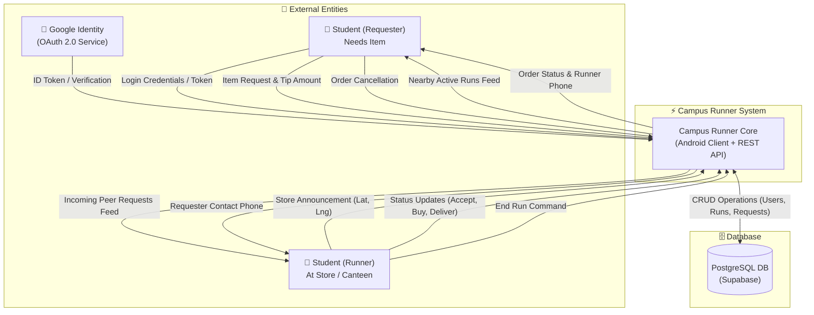
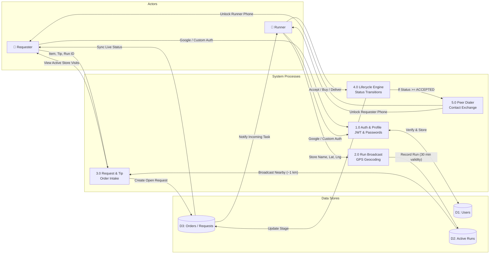
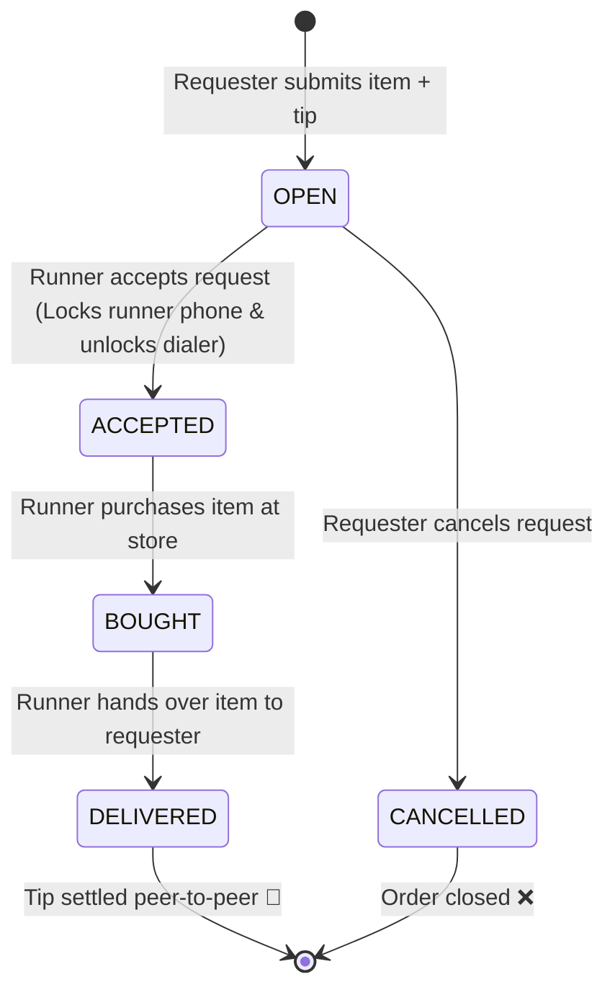
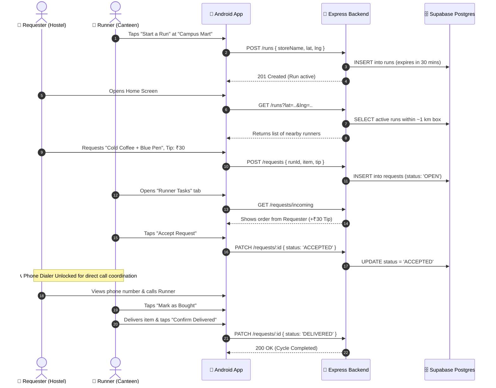

# 🏃 Campus Runner

> **A Peer-to-Peer Campus Shopping & Delivery Application**  
> *Shop · Request · Deliver — Within Your Campus*

[](https://kotlinlang.org)
[](https://developer.android.com)
[](https://developer.android.com/jetpack/compose)
[](https://nodejs.org)
[-336791.svg?logo=postgresql)](https://supabase.com)
[](https://sequelize.org)

---

## 📌 Overview

**Campus Runner** connects students who are physically present at campus stores, canteens, stationery shops, or pharmacies with students in hostels or classrooms who need items delivered.

Instead of informal, cluttered WhatsApp groups or walking long distances for small errands, **Campus Runner** turns everyday campus favors into a structured, location-aware, peer-to-peer delivery system with transparent tips and order tracking.

---

## 📊 Data Flow Diagrams (DFD)

### 🔹 DFD Level 0 — Context Diagram
The Level 0 diagram illustrates the external entities interacting with the **Campus Runner System** boundary:



---

### 🔹 DFD Level 1 — Detailed System Processes
The Level 1 diagram breaks the system down into core functional processes and datastores:



---

## 🔄 Order Lifecycle State Machine

Requests move through strict, validated states with authorization guards:



---

## ⚡ End-to-End Sequence Walkthrough



---

## 🌟 Campus Storylines ("A Day in the Life")

### ☕ Scenario A: The Late-Night Study Session
> **Aarav** is preparing for exams in Hostel 4 at 11:30 PM. He urgently needs a notebook and highlighters from the night canteen.
> 
> 1. Aarav opens **Campus Runner** and spots that **Sneha** has an active run at *Central Convenience Store*.
> 2. He sends a request: *"1 Register + 2 Highlighters"* with a **₹35 Tip**.
> 3. Sneha accepts with one tap, buys the items while paying for her own snacks, and calls Aarav via the integrated one-tap dialer upon reaching his hostel gate.
> 4. Aarav gets his study material without losing 45 minutes of study time; Sneha earns pocket money for zero extra detour.

---

## ✨ Key Features

### 🔐 Authentication & Onboarding
- **3-Step Onboarding Walkthrough**: Interactive intro explaining Requesting, Running & Earning, and Safe Community connection with animated indicator dots.
- **Dual Authentication**:
  - **Google OAuth 2.0**: Native sign-in powered by Android's Credential Manager.
  - **Custom Email & Password**: Secure student registration and login with `scrypt` password hashing.
- **Student Profile**: Name, campus email, and phone number management.

### 🏃 Store Runs ("I'm at a Store")
- **One-Tap Announcement**: Students at a campus store can broadcast their run with a 30-minute validity.
- **Location Awareness**: GPS capture using Android's Fused Location Provider.
- **Run Lifecycle**: Automatically deactivates previous runs and removes the run upon leaving the store.

### 🛍️ Item Requests & Tip Settlement
- **Nearby Run Discovery**: Browse active runs within a ~1 km radius on campus.
- **Create Order**: Send an item request with a custom tip amount.
- **Real-Time Lifecycle Tracking**:
  $$\text{OPEN} \longrightarrow \text{ACCEPTED} \longrightarrow \text{BOUGHT} \longrightarrow \text{DELIVERED}$$
- **Direct Phone Contact**: Once accepted, direct phone call integration (`tel:`) unlocks between runner and buyer.

### 📋 Dual Task Management (Orders & Runner Tasks)
- **My Orders**: Requesters track incoming purchases with ability to cancel open requests.
- **Runner Tasks**: Runners accept requests, mark items bought, and confirm delivery.

---

## 🛡️ Security & Privacy Protections

- **Two-Phase Phone Masking**: Student phone numbers are strictly **hidden** during the `OPEN` stage. Phone contacts are only revealed after the runner explicitly accepts the task.
- **Anti-Self Delivery Check**: Backend rejects students attempting to place orders on their own runs (`runnerId != req.uid`).
- **Geo-Fenced Expiration**: Runs expire automatically after 30 minutes, keeping discovery feeds fresh.
- **Password Salting**: Custom passwords hashed with dynamic 16-byte random salts via `crypto.scryptSync`.

---

## 🏗️ Architecture & Tech Stack

### Android Client
- **UI Framework**: 100% Kotlin with **Jetpack Compose** & Material 3.
- **Architecture**: **MVVM (Model-View-ViewModel)** with Repository Pattern.
- **Asynchronous State**: Kotlin Coroutines & `StateFlow`.
- **Networking**: Retrofit 2 + OkHttp + Gson Converter + Auth Token Interceptor.
- **Local Persistence**: Offline-first DAO caching layer.
- **Location Services**: Google Play Services Fused Location Provider.
- **Identity**: Google Credential Manager & `GetGoogleIdOption`.

### Backend & Database
- **Runtime**: Node.js & Express.
- **Database**: PostgreSQL hosted on **Supabase** via connection pooler.
- **ORM**: **Sequelize ORM** with declarative models, associations, and auto-camelCase mappings.
- **Security**: JWT session tokens (`jsonwebtoken`), password hashing via built-in `crypto.scryptSync`.

---

## 📁 Project Structure

```text
CampusRunner/
├── app/                                 # Android Client Application
│   ├── src/main/java/com/example/campusrunner/
│   │   ├── data/
│   │   │   ├── local/                   # Room / Local DAO Caching & Entities
│   │   │   ├── remote/                  # Retrofit API Service, DTOs & Interceptor
│   │   │   └── repository/              # AuthRepository, RunRepository, RequestRepository
│   │   ├── location/                    # FusedLocationProviderClient wrapper
│   │   ├── ui/
│   │   │   ├── auth/                    # Login & Sign-Up Screen
│   │   │   ├── home/                    # Home Screen, Run Announcements & Discovery
│   │   │   ├── onboarding/              # 3-Page Walkthrough Screen
│   │   │   ├── requests/                # Buyer Orders & Runner Tasks with Call Action
│   │   │   ├── splash/                  # Splash Screen
│   │   │   └── navigation/              # NavHost, Bottom Navigation & Routing
│   │   ├── AppContainer.kt              # Dependency Injection Container
│   │   └── MainActivity.kt              # Single Activity Entry Point
│   └── build.gradle.kts
│
├── Backend/                             # REST API Backend
│   ├── models/                          # Sequelize ORM Models (User, Run, Request)
│   ├── routes/                          # Express Routes (auth, users, runs, requests)
│   ├── middleware/                      # JWT Authentication Guard
│   ├── db.js                            # Sequelize Database Connection
│   ├── schema.sql                       # PostgreSQL Database Schema
│   ├── test-flow.js                     # End-to-End Automated Test Suite
│   ├── index.js                         # Server Entry Point
│   └── package.json
│
├── .gitignore                           # Configured for Android, Node, Gradle & Secrets
└── README.md
```

---

## 📡 REST API Reference

| Method | Endpoint | Description | Auth Required |
| :--- | :--- | :--- | :---: |
| `POST` | `/auth/signup` | Register new student with name, email, password, phone | No |
| `POST` | `/auth/login` | Login with email and password | No |
| `POST` | `/auth/google` | Verify Google ID token and issue JWT | No |
| `GET` | `/users/me` | Fetch authenticated user profile | Yes (Bearer) |
| `PATCH` | `/users/me` | Update student phone number | Yes (Bearer) |
| `GET` | `/runs?lat=..&lng=..` | Fetch active runs within 1 km radius | Yes (Bearer) |
| `GET` | `/runs/mine` | Get current active run for user | Yes (Bearer) |
| `POST` | `/runs` | Start a run at a store (lat, lng, storeName) | Yes (Bearer) |
| `POST` | `/runs/:id/end` | End an active run | Yes (Bearer) |
| `POST` | `/requests` | Create request for a run (item, tip) | Yes (Bearer) |
| `GET` | `/requests/incoming` | Get requests assigned to current runner | Yes (Bearer) |
| `GET` | `/requests/mine` | Get requests made by current student | Yes (Bearer) |
| `PATCH` | `/requests/:id` | Update status (`ACCEPTED`, `BOUGHT`, `DELIVERED`, `CANCELLED`) | Yes (Bearer) |

---

## 🚀 Getting Started

### 1. Prerequisites
- **Android Studio** (Koala / Ladybug or newer)
- **JDK 17+**
- **Node.js 18+** & npm

### 2. Backend Setup
```bash
cd Backend

# 1. Install dependencies
npm install

# 2. Configure Environment Variables
cp .env.example .env
# Fill in your DATABASE_URL (Supabase/Postgres), JWT_SECRET, and GOOGLE_CLIENT_ID

# 3. Start the Server
npm start
# Server runs on port 3000 (or PORT specified in .env)

# 4. (Optional) Run Automated Tests
node test-flow.js
```

### 3. Android Client Setup
1. Open the root `CampusRunner` directory in **Android Studio**.
2. Wait for Gradle Sync to complete.
3. In `app/src/main/java/com/example/campusrunner/AppContainer.kt`, verify `baseUrl` points to your backend:
   - Android Emulator: `http://10.0.2.2:3000/`
   - Physical Device: Your machine's local Wi-Fi IP or ngrok tunnel URL.
4. Run the app on an Android device or emulator (Android 7.0 / API 24+).

---

## 🧪 Testing

### Backend Integration Tests
```bash
cd Backend
node test-flow.js
```
*Validates 27 automated test cases covering auth, token guards, run expirations, distance calculations, request lifecycles, and security checks.*

### Android Unit Tests
```bash
./gradlew testDebugUnitTest
```
*Executes local unit tests covering ViewModels, StateFlows, and Repository operations.*

---

## 📄 License
This project is developed for academic and campus utility purposes.
